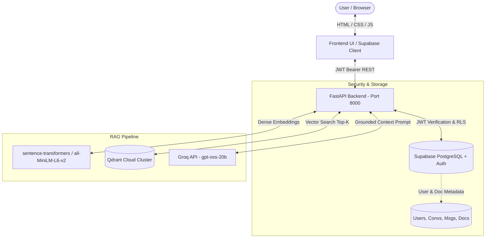

# 🧠 RAG from Scratch — AI Knowledge & Chat Platform

[](https://fastapi.tiangolo.com)
[](https://www.python.org)
[](https://cloud.qdrant.io)
[](https://supabase.com)
[](https://groq.com)
[](https://www.langchain.com)

Welcome to **RAG from Scratch**! 🚀  
This is a full-stack, production-grade **Retrieval-Augmented Generation (RAG)** platform designed to turn complex PDF documents into an interactive, multi-turn AI knowledge assistant. 

Unlike basic toy demos, this project features **multi-user authentication**, **Row-Level Security (RLS)**, a **global shared knowledge base** backed by **Qdrant Cloud**, and **history-aware conversational AI** that cites exact sources and page numbers.

---

## ✨ Features at a Glance

- 🔍 **Grounded AI Generation**: Ask complex questions and get answers backed exclusively by document contents, complete with clickable source tags and page citations.
- ⚡ **Ultra-Fast LLM Inference**: Powered by **Groq Cloud** for near-instantaneous streaming answers.
- 📚 **Global Shared Knowledge Base**: Ingest multi-page PDFs with chunking, embedding generation (`sentence-transformers/all-MiniLM-L6-v2`), and real-time syncing to **Qdrant Cloud**.
- 💬 **Context & History-Aware Conversations**: Automatically re-formulates follow-up queries based on previous chat context so the conversation flows naturally.
- 🔒 **Multi-User Security & Isolation**:
  - Secure signup and login powered by **Supabase Auth**.
  - Three-tier backend JWT verification (Auth API $\rightarrow$ Asymmetric JWKS ES256 $\rightarrow$ HS256).
  - PostgreSQL **Row-Level Security (RLS)** ensures private chat histories and messages are isolated per user.
- 🎨 **Warm Modern UI**: Custom cream & khaki aesthetic, responsive sidebar, document management dashboard, and clean modal upload screens.

---

## 🏗️ Architecture



---

## 🛠️ Tech Stack

| Layer | Technologies |
|---|---|
| **Frontend** | Vanilla HTML5, Modern CSS (Warm Theme), Vanilla JavaScript (ES6+), Supabase JS SDK v2 |
| **Backend** | Python, FastAPI, Uvicorn, Pydantic |
| **Vector Engine** | [Qdrant Cloud](https://cloud.qdrant.io/) (Collection: `rag_documents_v2`, 384 dimensions) |
| **Relational DB & Auth**| [Supabase](https://supabase.com/) (PostgreSQL, Auth, Row-Level Security, Cascade Triggers) |
| **AI & Embeddings** | [Groq](https://groq.com) (`openai/gpt-oss-20b`), HuggingFace `sentence-transformers/all-MiniLM-L6-v2`, LangChain |

---

## 📂 Project Structure

```text
├── Backend/
│   ├── api/
│   │   ├── auth_middleware.py     # Cryptographic JWT validation & user dependencies
│   │   ├── conversations.py       # Private user chat conversation CRUD
│   │   └── upload.py              # PDF document upload & metadata registration
│   ├── services/
│   │   ├── ingestion_service.py   # PDF text extraction, chunking & parsing
│   │   ├── qdrant_service.py      # Qdrant Cloud client & vector index operations
│   │   └── supabase_service.py    # PostgreSQL queries, session management & JWT verification
│   └── main.py                    # FastAPI server entry point, CORS, routers & startup lifespan
├── Frontend/
│   ├── index.html                 # Main chat interface with source pills & sidebar
│   ├── login.html                 # Sign In / Create Account with Supabase Auth
│   ├── documents.html             # Shared Knowledge Base dashboard
│   ├── upload.html                # PDF drag-and-drop document uploader
│   ├── css/
│   │   └── common.css             # Unified warm design tokens & components
│   └── js/
│       ├── api.js                 # Backend REST client wrapper
│       ├── auth.js                # Session persistence, route protection & sign-out
│       ├── chat.js                # Real-time chat streaming & UI rendering
│       ├── documents.js           # Document explorer & vector stats
│       ├── history.js             # Sidebar conversation threads manager
│       └── supabaseClient.js      # Supabase client singleton initialization
├── history_aware_generation.py    # Core LangChain RAG pipeline with query reformulation
├── ingestion_pipeline.py          # Document chunking & vectorization pipeline
├── retrieval_pipeline.py          # Similarity retriever configuration
├── supabase_schema.sql            # Database schema, foreign keys, triggers & RLS policies
├── SQL_FIXES.sql                  # Production least-privilege database permissions
├── sync_qdrant_to_supabase.py     # Utility to synchronize Qdrant index with Supabase
└── test_security_auth.py          # Comprehensive 12-point authentication security test suite
```

---

## 🚀 Getting Started

### 1. Clone the Repository
```bash
git clone https://github.com/chowdhurysambu10-alt/Rag_from_scratch.git
cd Rag_from_scratch
```

### 2. Set Up Python Virtual Environment
```bash
python3 -m venv venv
source venv/bin/activate
pip install -r requirements.txt
```

### 3. Configure Environment Variables
Copy `.env.example` to `.env`:
```bash
cp .env.example .env
```

Fill in your API keys in `.env`:
```env
# Groq LLM API
GROQ_API_KEY="your-groq-api-key"
GROQ_MODEL="openai/gpt-oss-20b"

# Qdrant Cloud Vector Database
QDRANT_URL="https://your-cluster-id.cloud.qdrant.io:6333"
QDRANT_API_KEY="your-qdrant-api-key"
QDRANT_COLLECTION="rag_documents_v2"

# HuggingFace Embedding Model
EMBEDDING_MODEL="sentence-transformers/all-MiniLM-L6-v2"

# Supabase Configuration
SUPABASE_URL="https://your-project-id.supabase.co"
SUPABASE_KEY="your-supabase-service-role-key"
SUPABASE_ANON_KEY="your-supabase-anon-key"
SUPABASE_JWT_SECRET="your-supabase-jwt-secret"
```

### 4. Initialize Database & RLS
Open the **SQL Editor** in your Supabase dashboard and run:
1. `supabase_schema.sql` (Creates tables, triggers, and base RLS policies).
2. `SQL_FIXES.sql` (Applies production-ready least-privilege permissions and tightens document access).

### 5. Launch the Backend Server
```bash
uvicorn Backend.main:app --host 127.0.0.1 --port 8000 --reload
```

The server will automatically load and pre-warm the embedding models on startup.

### 6. Access the Application
Open your browser and navigate to:
- **Login / Sign Up**: [http://127.0.0.1:8000/Frontend/login.html](http://127.0.0.1:8000/Frontend/login.html)
- **Chat App**: [http://127.0.0.1:8000/Frontend/index.html](http://127.0.0.1:8000/Frontend/index.html)
- **Document Management**: [http://127.0.0.1:8000/Frontend/documents.html](http://127.0.0.1:8000/Frontend/documents.html)
- **Interactive Swagger Docs**: [http://127.0.0.1:8000/docs](http://127.0.0.1:8000/docs)

---

## 🧪 Testing

The repository includes test suites to verify system integrity:

```bash
# Run multi-user security and JWT authorization tests (12 tests)
python3 test_security_auth.py

# Test Qdrant vector retrieval and document grounding
python3 test_qdrant_rag.py

# Verify synchronization between Qdrant and Supabase
python3 test_rag_synchronization.py
```

---

## 🤝 Contributing

Contributions, issues, and feature requests are always welcome! Feel free to fork the repository and open a Pull Request.
if you find any issues you cab email 

---

## 📄 License

This project is licensed under the [MIT License](LICENSE). Feel free to use it for personal projects, learning, or production deployments.
